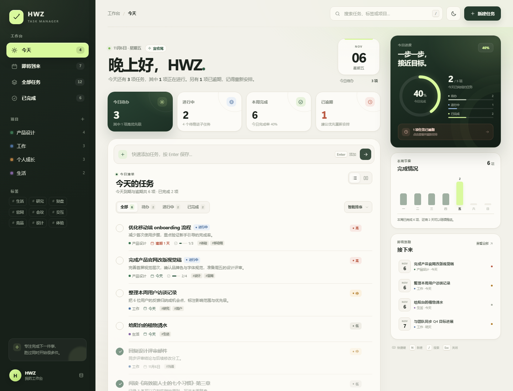
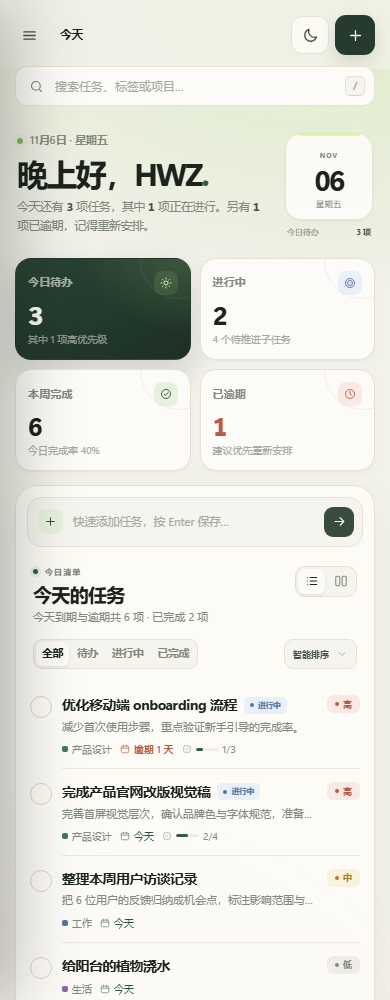

<div align="center">

  

  # HWZ Task Manager

  **简洁、清晰、专注于当下的现代任务管理器。**

  无需注册，无需后端。打开浏览器，即可开始整理今天。

  [GitHub 仓库](https://github.com/HWZ-ch/HWZ-Task-Manager) · [功能](#功能) · [快速开始](#快速开始) · [快捷键](#快捷键)

</div>



<p align="center">
  
  <br>
  <sub>移动端同样完整可用</sub>
</p>

## 简介

HWZ Task Manager 是一个**本地优先**的单页任务管理器，使用原生 HTML、CSS 和 JavaScript 构建，没有任何运行时依赖。

它把「今天要做什么」放在界面最核心的位置：任务状态、优先级、项目、标签、截止日期和子任务都能一眼看清；同时用进度环、本周节奏和即将到期列表，帮你判断节奏而不是被清单淹没。

所有任务保存在浏览器本地，刷新不会丢失。支持 JSON 导入 / 导出，方便备份与迁移。

## 功能

### 清晰的工作台
- 今日欢迎区、日期卡片与专注提示
- 今日待办、进行中、本周完成、逾期任务四项概览
- 今日进度环与待办 / 进行中 / 已完成分解
- 本周每日完成柱状图
- 即将到期任务速览

### 完整的任务管理
- 新建、编辑、完成、删除与撤销删除
- 待办 / 进行中 / 已完成三种状态
- 高 / 中 / 低优先级
- 截止日期、项目归属、标签、描述
- 子任务清单与完成进度
- 顶栏快速添加，按 `Enter` 直接创建

### 高效的浏览方式
- 列表视图与看板视图
- 看板支持拖拽任务切换状态
- 按状态筛选
- 智能 / 截止日期 / 优先级 / 最近创建排序
- 全局搜索标题、描述、标签、子任务和项目
- 今日、即将到来、全部任务、已完成、项目与标签多维筛选

### 体贴的体验
- 浅色 / 深色主题，记忆偏好
- 桌面、平板与手机响应式布局
- 全中文界面与无障碍语义
- 删除、完成、导入、重置均支持撤销
- 本地 JSON 数据备份与恢复
- 键盘快捷键

## 快速开始

### 方式一：直接打开

下载本仓库后，双击 `index.html` 即可使用。

### 方式二：本地服务器（推荐）

```bash
# 在项目目录中执行
python -m http.server 8080

# 浏览器访问
http://localhost:8080
```

无需安装依赖，无需构建。

## 快捷键

| 快捷键 | 功能 |
| --- | --- |
| `N` | 新建任务 |
| `/` | 聚焦搜索 |
| `Esc` | 关闭面板 / 清除当前焦点 |
| `Ctrl` + `Enter` / `⌘` + `Enter` | 在任务详情中保存 |

## 数据说明

- 数据保存在浏览器的 `localStorage` 中，键名为 `hwz-task-manager:v1`。
- 主题、视图和排序偏好保存在 `hwz-task-manager:prefs`。
- 任务不会上传到服务器。清除浏览器数据会同时清除任务，请定期通过「数据管理 → 导出数据」备份。
- 导入支持本应用导出的 JSON 格式；导入和重置操作均可撤销。

## 技术栈

- 原生 HTML5 / CSS3 / JavaScript（ES6+）
- CSS Grid、Flexbox、CSS 变量与响应式媒体查询
- 原生拖放 API
- Web Storage API
- 零依赖、零构建步骤
- GitHub Pages 静态托管

## 项目结构

```text
HWZ-Task-Manager/
├── index.html                 # 页面结构与图标
├── styles.css                # 设计系统、布局与响应式样式
├── app.js                    # 数据模型、状态与交互逻辑
├── manifest.webmanifest      # Web App Manifest
├── assets/
│   └── favicon.svg           # 站点图标
├── docs/
│   └── preview.png           # README 预览图
├── README.md
└── LICENSE
```

## 部署到 GitHub Pages

1. 将代码推送到 GitHub 仓库的 `main` 分支。
2. 打开仓库 **Settings → Pages**。
3. 在 **Build and deployment** 中选择 **Deploy from a branch**。
4. 选择 `main` 分支与 `/ (root)` 目录，保存即可。

部署完成后访问：`https://hwz-ch.github.io/HWZ-Task-Manager/`

## 说明

GitHub 仓库名不支持空格，因此仓库地址使用连字符形式：`HWZ-Task-Manager`。项目显示名仍为 **HWZ Task Manager**。

## License

[MIT](LICENSE) © 2026 HWZ-ch

---

<div align="center">

[](https://github.com/deepseek-ai/deepseek-harness)

</div>